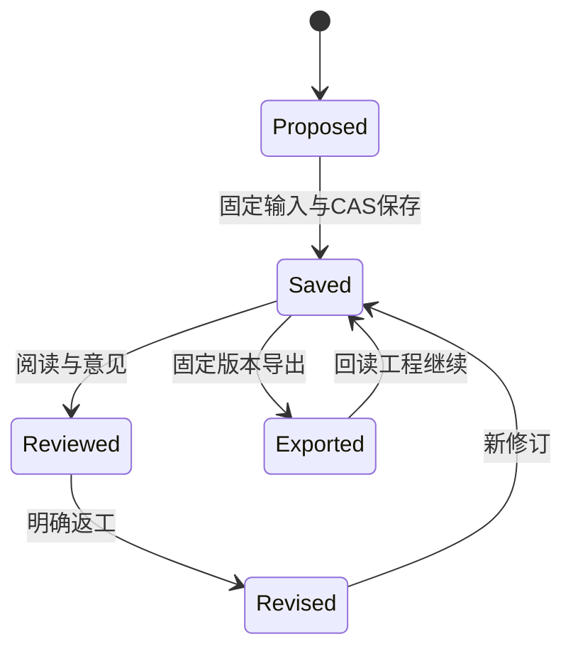
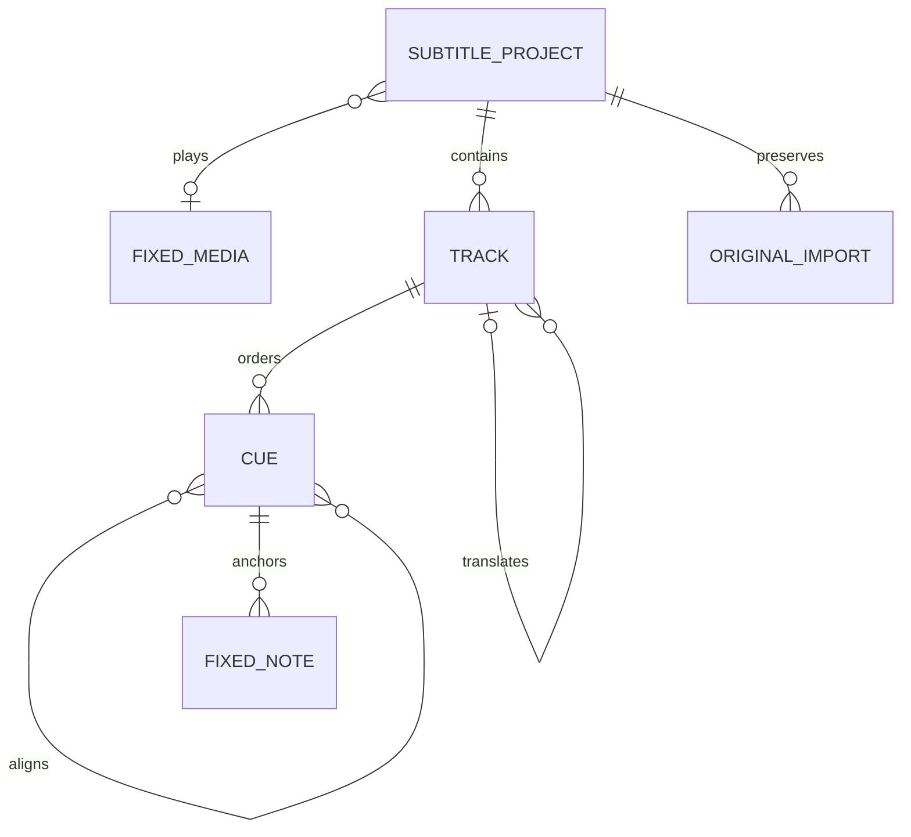

# 领域与本体设计

## 领域边界

实际识别、翻译、配音和烧录由作者选择的外部Agent工具完成。本包不伪造逐字时间，不把估计对齐标为人工核准。v1读取SRT、VTT及ASS基础Dialogue；样式、特效、定位与格式控制可能损失，预览明确报告，不声称完整ASS往返。

| Owner | 拥有的事实 |
| --- | --- |
| 河图Core | WorkRef、固定来源、专业对象修订、CAS、原操作、正式正文及作者决定 |
| 本插件 | 专业结构、计算、专业偏好、视图与可再生成导出 |
| 外部Agent | 理解、规划、内容生成与方法执行 |
| 作者 | 取舍、采纳、定稿、内容外发和费用决定 |

## 核心本体

| 对象 | 存储集合 | 创作含义 |
| --- | --- | --- |
| track | tracks | 字幕轨 |
| cue | cues | 字幕条目 |
| note | notes | 字幕意见 |

所有局部ID只在当前专业工程中有意义；同名、同ID或相同版本号不能跨作品推定身份。引用正文时固定UTF-8字节区间与原引文；引用媒体时固定宿主素材修订和摘要。

## 关系与不变量

track 1—N cue；translated track N—1 source track；cue N—N source cue；note N—1 fixed cue；project N—1 fixed asset。

每个集合ID唯一，外键必须存在；删除仍被使用的对象拒绝保存。全对象更新与细粒度动作遵循同一校验，不存在绕过领域规则的编辑入口。来源更新先说明影响，再明确建立新修订。专业选中状态不扩大成宿主选用或作者定稿。

## 领域推断的证据边界

SRT/VTT/ASS、UTF-8 BOM、CRLF、中文与多行、严格时间戳

倒置时间拒绝；重叠、短间隔、超时长和阅读速度明确报告

平移正负偏移原子校验，越界不保存，旧意见变为stale

双语一对多与多对一，禁止跨错源轨或循环依赖

危险HTML转义、ASS控制损失、完整导出回读与实际媒体播放

## 专业对象状态

此状态图描述工作旅程，不新增重复的数据库状态机。正文采纳与定稿由宿主另行处理。

## 专业关系图

图中实体为专业工程内的逻辑关系，固定素材和设定仍由宿主管理；不新增对应的外部数据库表。跨工程引用必须带作品、Owner、修订及摘要。
