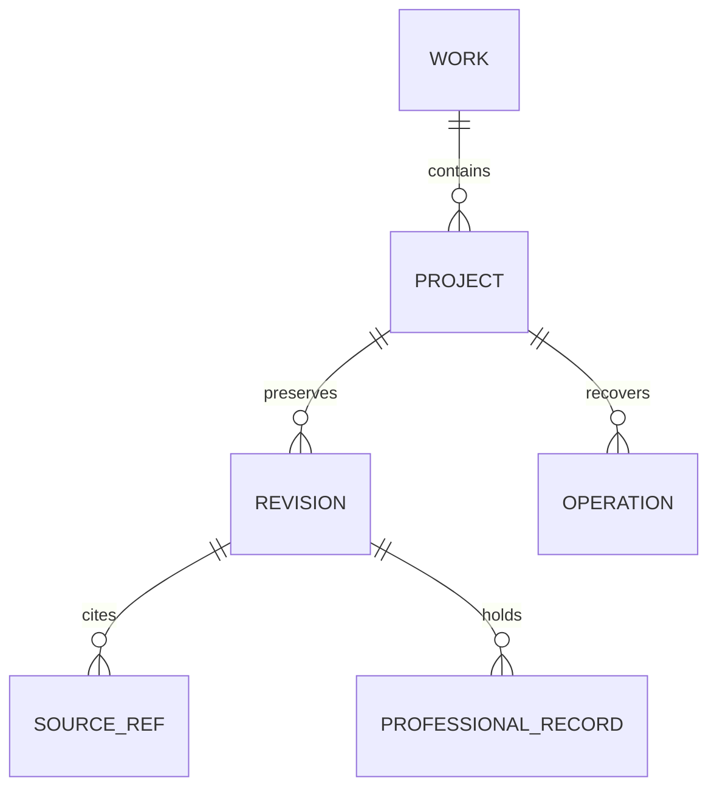
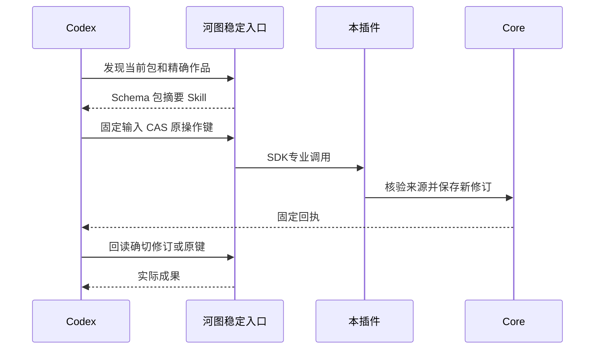

# 数据与API设计

## 数据格式

宿主包外壳按其Draft-07清单校验；专业数据与动作由Ajv2020独立校验，两者不混用。唯一可执行Schema是[包清单](../contracts/plugin-manifest.json)，`additionalProperties=false`拒绝拼错字段。`format_version=1`，Schema版本`1.0.0`；升级不得裁掉新字段覆盖旧数据。

| 根字段 | 类型 | 必填 |
| --- | --- | --- |
| format_version | constant | 是 |
| title | string | 是 |
| basis_refs | array | 是 |
| media | object | 是 |
| reading | object | 是 |
| imports | array | 是 |
| tracks | array | 是 |
| cues | array | 是 |
| notes | array | 是 |

### 字幕轨 `tracks`

| 字段 | 类型／范围 |
| --- | --- |
| id | `{"type":"string","minLength":1,"maxLength":100}` |
| title | `{"type":"string","minLength":1,"maxLength":200}` |
| language | `{"type":"string","minLength":1,"maxLength":50}` |
| source_track_id | `{"anyOf":[{"type":"string","minLength":1,"maxLength":100},{"type":"null"}]}` |

### 字幕条目 `cues`

| 字段 | 类型／范围 |
| --- | --- |
| id | `{"type":"string","minLength":1,"maxLength":100}` |
| track_id | `{"type":"string","minLength":1,"maxLength":100}` |
| start_ms | `{"type":"integer","minimum":0,"maximum":86400000}` |
| end_ms | `{"type":"integer","minimum":1,"maximum":86400000}` |
| text | `{"type":"string","minLength":1,"maxLength":8000}` |
| speaker | `{"type":"string","minLength":0,"maxLength":200}` |
| source_cue_ids | `{"type":"array","items":{"type":"string","minLength":1,"maxLength":100},"maxItems":100}` |
| alignment | `{"enum":["manual","imported","estimated"]}` |

### 字幕意见 `notes`

| 字段 | 类型／范围 |
| --- | --- |
| id | `{"type":"string","minLength":1,"maxLength":100}` |
| cue_id | `{"type":"string","minLength":1,"maxLength":100}` |
| cue_sha256 | `{"type":"string","pattern":"^[a-f0-9]{64}$"}` |
| comment | `{"type":"string","minLength":1,"maxLength":8000}` |
| status | `{"enum":["open","resolved"]}` |
| resolution | `{"type":"string","minLength":0,"maxLength":4000}` |

## 数据库与持久化

本包不新增SQLite或第二个作品数据库。使用公开SDK的ProjectStore保存`subtitle_studio`专业对象。宿主保存不可变修订，插件只提交内容和固定来源。

| 逻辑记录 | 主键／关系 | 维护Owner |
| --- | --- | --- |
| 专业对象 | WorkRef＋Owner＋object_id | Core |
| 专业修订 | object_id＋revision，sha256，previous_sha256 | Core |
| 操作回执 | 工作区＋Owner＋operation_key | Core |
| 专业内容 | 上述根对象及集合局部ID | 本包 |
| 来源／专业依据 | 固定WorkRef、修订与摘要 | 原Owner |

## 公开API

Codex先调用河图实际能力发现，再用`hetu.plugins.capabilities`取得本包Schema和摘要，最终通过`hetu.plugins.invoke`调用。绑定精确WorkRef、management_ref、plugin_id、package_sha256及capabilities_sha256；不将路径或标题当身份。

| 动作 | 用途 | 效果 |
| --- | --- | --- |
| list_projects | 查找专业工程 | read |
| get_project | 读取固定专业工程 | read |
| save_project | 保存专业工程 | managed_write |
| put_track | 维护字幕轨 | managed_write |
| remove_track | 移除字幕轨 | managed_write |
| put_cue | 维护字幕条目 | managed_write |
| remove_cue | 移除字幕条目 | managed_write |
| put_note | 维护字幕意见 | managed_write |
| remove_note | 移除字幕意见 | managed_write |
| preview_import | 预览字幕转换与损失 | read |
| import_subtitles | 导入固定字幕轨 | managed_write |
| check_subtitles | 检查时间与阅读负担 | read |
| export_subtitles | 导出固定字幕文件 | read |
| shift_track | 平移字幕轨 | managed_write |
| locate_time | 定位时刻字幕 | read |
| cue_digest | 读取字幕固定摘要 | read |
| get_source | 读取固定来源 | read |
| get_basis | 读取固定专业依据 | read |
| compare_versions | 比较固定修订 | read |
| export_project | 导出固定专业报告 | read |
| build_context | 准备有界创作上下文 | read |
| create_handoff | 准备精确AI交接 | read |
| get_operation | 回读原操作 | read |

逐字段参数归清单，生成的[功能清单](../CAPABILITIES.md)和[方法操作地图](../skills/hetu-subtitle-studio/references/operations.md)提供导航。

## 写入与错误

新建使用expected_revision=0和空expected_sha256；更新使用回读的确切修订和摘要，所有写入携带原operation_key。同键同输入回读原成果，同键不同输入拒绝；冲突保留输入。错误包括invalid_input、revision_conflict、idempotency_conflict、not_found和hetu.budget_exceeded，以实际宿主回执为准。

导出按固定对象分块，核对offset、总长度、分块与完整SHA-256。UTF-8分块不能切断字符，二进制不经字符串转码。

## 字幕原件与转换损失

`imports`保存track_id、format、filename、原件base64、SHA-256及losses。每次校验原件摘要与实际解析损失，旧导入记录不可删除或替换；移除当前字幕轨不移除其历史原件。上下文自动省略base64，完整专业JSON导出保留原件以便审计。首版未提供完整ASS样式往返。
